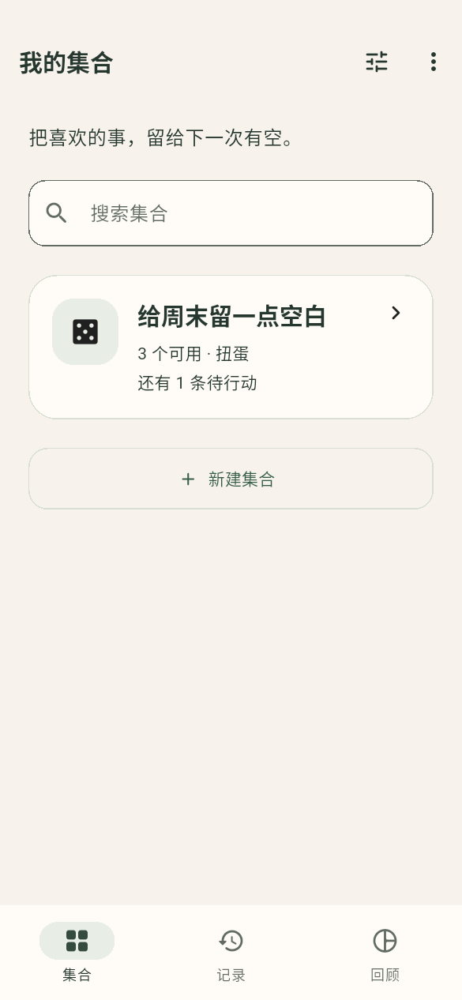
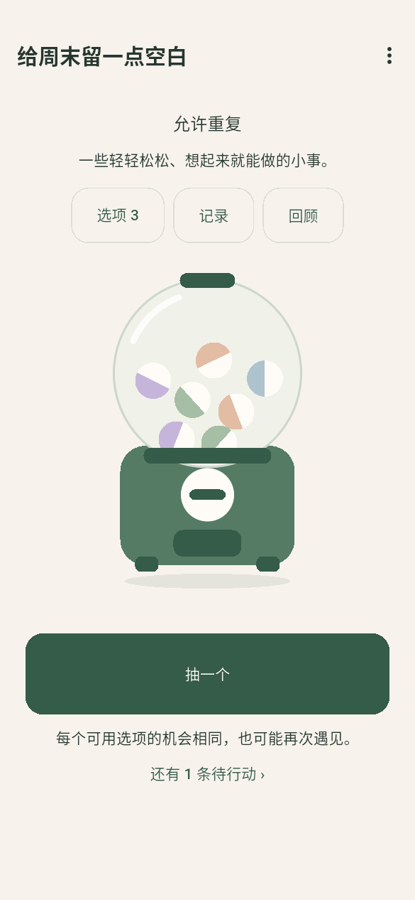
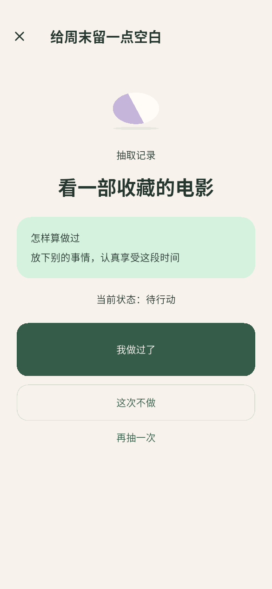

# 随手抽 · so-do-what

把想做的事装进集合，抽一个开始。Android 优先，本地离线、免费、无广告，没有账号、后台或统计上报。

## 已实现

- 集合与选项：创建编辑、搜索、归档恢复、启用停用、拖动排序、逐行批量导入与分类预览；标题 NFC 去重。
- 三种等概率规则：允许重复、仅避免连续重复、整轮不重复。轮次跨重启和模式切换保留；耗尽须手动开启下一轮。
- 原创扭蛋演出与直接揭晓；支持跳过、系统/App 减动、音效和触感。结果先持久化，动画只展示已保存的记录。
- 结果独立完成/跳过/待行动，重抽保留旧记录；历史快照、筛选、搜索、分页和撤销。
- 全局/集合抽取数、完成数、待行动数、跳过数及执行率；全局按总完成数除以总抽取数。
- 浅色/深色/跟随系统；完整 JSON 备份、严格校验与覆盖恢复、二次确认清空。
- 正式空库不注入示例；体验演示与正式数据隔离。

## 界面

  

[完整扭蛋录屏](docs/recordings/gacha-android.mp4) · [截图目录](docs/screenshots/)

## 开发

实际验证工具链：Flutter 3.47.7 stable、Dart 3.13.5、JDK 17、Android SDK 36。将 Flutter 加入 PATH，配置 ANDROID_HOME/JAVA_HOME，然后：

```sh
flutter pub get
dart format lib test integration_test
flutter analyze
flutter test
flutter test integration_test -d <Android设备ID>
# 系统文件界面另需配套 ADB 自动化（Flutter/adb加入PATH，或设置FLUTTER_BIN/ANDROID_HOME）
python tool/test_native_documents.py
# 录制完整 Android 扭蛋流程
python tool/record_device_flow.py
flutter run
flutter build apk --debug
flutter build apk --release
```

集成测试会安装/卸载同包名测试应用，请使用专用模拟器；含真实数据的自用安装应先导出备份。

仅生成 Android 平台。开发包名 `dev.local.so_do_what`。当前 release 构建仍使用开发测试签名，供自用试用；正式签名与稳定升级密钥需要另行配置，密钥不得入库。Windows 跨盘 Pub Cache 的 Kotlin 增量缓存已关闭以避免路径冲突。

宿主 FFI 测试通过 sqlite3 官方 hook 配置使用系统库：Windows 为 winsqlite3.dll，其他宿主须提供 libsqlite3。正式 Android 业务使用 sqflite，不依赖宿主 DLL。

## 数据与备份

SQLite 位于 Android 应用私有目录 `databases/so_do_what.db`。卸载会移除本地数据；系统自动云备份和设备迁移关闭，请主动导出备份。导出的 JSON 为明文，可能包含集合与行动记录，请自行保管。导出/恢复通过系统文件界面进行，应用不主动上传。

恢复为完整覆盖：先验证、预览、明确确认，单事务替换。失败回滚原有数据。备份资源边界为 128 MiB；100 集合、每集合 1,000 项（含归档停用），历史无两万条截断上限。较新数据库格式拒绝覆盖。

数据库损坏时保留故障文件并拒绝写入。启动错误页可选择备份，完整校验和明确确认后，在保留原 db/WAL/SHM 的前提下换入新库；替换中断会在下次启动处理。较新格式拒绝降级。不要卸载或手工删库来处理故障。

## 验证与交付

详细结果、设备限制、截图位置见 [验证报告](docs/validation-report.md)，需求与验收依据在 [PRD](docs/PRD.md) 和 [计划](docs/plans/README.md)。未验证项目不代表通过。v0.1 首次交付按试用版本管理。

## 许可

项目采用 [Apache-2.0](LICENSE)（所有者于 2026-11-13 选择）。原创绘图、应用图标和合成音效采用相同许可。系统字体不随包分发；第三方许可见 [依赖核查](docs/dependency-audit.md)、[完整许可文本](docs/third-party-licenses.txt) 和 [资源清单](docs/asset-licenses.md)。
